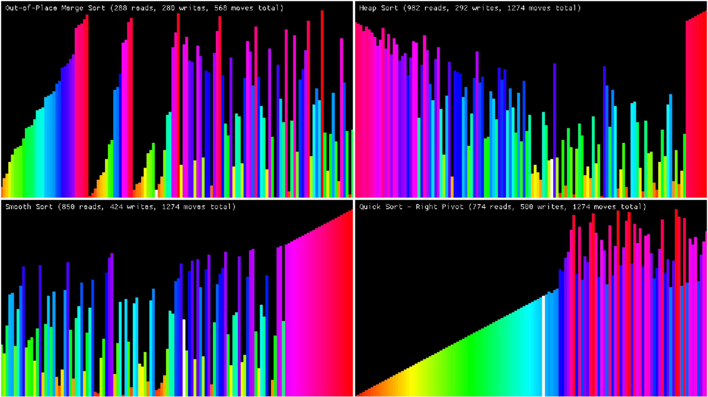

# sort-race-macroquad

A small Rust application to select up to 9 sorting algorithms and compare their performance.

## Installation (from source code)
- First, install Rust if you haven't already. The Rust website offers a good guide on how to do that: https://rust-lang.org/learn/get-started/
- Clone the repository to any directory on your computer, or download the files as a .zip and unzip it wherever you want.
- Navigate to that directory in your terminal, and enter `cargo run --release` to start the application.

## How to use
On the starting page, there are four main sub-windows: the list type, the sort type(s), the sort speed, and the number of elements in the list. Note that the sub-window for selecting the sort types is rather small - to see all of them, you'll have to scroll by clicking the scroll bar and dragging it (using the mouse wheel causes it to go straight to the bottom of the list). Select up to 9 sorts, set all the other parameters as you see fit, then hit the "Start sorting!" button at the bottom.

The sort screen itself has its own keyboard controls:
- **Space**: Play/pause the animation
- **Arrow keys**: Move forward/back through the individual read/write operations
- **R**: Reset all sorts - note that this will re-randomize the inputs, depending on which starting input you chose
- **T**: Activate "Turbo Mode", which speeds the sorting speed up by a factor of 10
- **Shift + T**: Activate "Super Turbo Mode", which speeds it up by a factor of 100
- **Q**: Go back to the previous screen

Finally, to quit the application, press **Esc** at any time.
